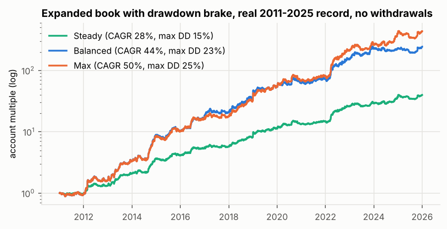
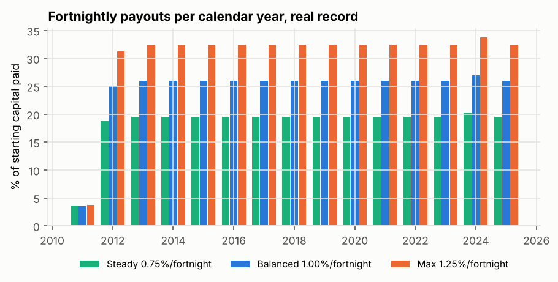

# Hunt 2 — the expanded book and its risk system

What the ORB study taught, applied: chart patterns at session opens carry almost no
information after costs, so look for (1) effects with a structural reason to exist, judged by
their move per day in units of trading cost; (2) breadth for the trend legs that already work;
(3) a risk system compared at equal drawdown risk, not at equal settings.

## 1. Structural intraday flows (`seasonal_scan.py`, `windows.py`, `windows2.py`)

Average move of every hour of the day on every market, in multiples of the all-in cost, with
t-statistics for 2011–2018 and 2019–2025 and the number of years with the same sign.

- The largest "effects" are at 21:00–24:00 London (the 17:00 New York rollover). Spreads blow
  out there and bid prices dip and recover, so these moves cannot be traded. Excluded.
- **EURUSD weakens during European working hours** (London 11:00 and 12:00, 14 of 15 years),
  the published "currencies depreciate in their own trading hours" pattern (Breedon & Ranaldo).
  Best window chosen on 2011–2018 only: short 09:00–13:00 London, about 2 costs of move a day,
  positive out-of-sample. Gold's Asian-hours drift, all gold, GBP and yen windows fail out-of-sample.
- Yen "gotobi" days: USDJPY rises into the 09:55 Tokyo fix (t 3.4 in-sample), but by only 1.3
  costs a day and weaker since 2019. Too thin to trade.
- London 4 pm fix reversal: real but worth only half a cost per trade; month-end 1.4–1.9 costs
  but only 12 trades a year. Not used.

**Euro European-hours leg** (`euro_hours.py`): sell EURUSD at 09:00 London, buy back at 13:00,
protective stop 0.5 x daily ATR. Every weekday: 259 trades/yr, +0.021R, t 2.07, all eras positive.
Tuesday–Thursday only: 155/yr, +0.041R, t 2.95, eras +0.042 / +0.066 / +0.029.
The Tuesday–Thursday rule was the best of 6 pre-listed variants. The book result with the
every-weekday version is shown below, and it barely changes.

## 2. Breadth: cross pairs built from the majors (`crosses.py`)

EURJPY, GBPJPY and EURGBP minute bars built from the four traded pairs (171 family variants on
H1/H4/D1, all-in costs 2.0 / 3.0 / 1.5 pips). Nothing passes every gate. Two timeless
candidates: GBPJPY H4 Donchian 20 with trail (+0.10R, t 1.6) and EURGBP D1 Bollinger 1.5
reversion (+0.05R, t 1.2).

## 3. The expanded book (`book_v3.py`, same rules as the current book)

Timeless gate, greedy monthly correlation < 0.30, weights = inverse monthly volatility on 2011–2018.

| | current book (8 legs) | expanded book (11 legs) |
|---|---|---|
| trades per year | 186 | 412 |
| monthly Sharpe, whole period | 1.32 | **1.52** |
| 2011–2018 / 2019–2025 | 1.46 / 1.22 | 1.69 / **1.35** |
| positive months / years | 61% / 14 of 15 | **68% / 15 of 15** |

New legs: EUR European-hours short (Tue–Thu, weight 0.19), GBPJPY H4 Donchian (0.15), EURGBP D1
Bollinger (0.37). The euro leg's correlation with every other leg is 0.00.

## 4. Risk systems at equal drawdown risk (`risk_lab.py`, `compare.py`, `cap_test.py`)

Each policy's base risk is solved so the median maximum drawdown over 1,000 reshuffled 15-year
histories (whole calendar quarters of the real trade record, re-ordered) equals the budget.

| median DD budget 25% | median CAGR | 1-in-20 CAGR | 1-in-20 DD | worst DD |
|---|---|---|---|---|
| fixed fractional | 41% | 27% | 36% | 50% |
| volatility targeting | 38% | 26% | 37% | 52% |
| **drawdown brake** | **44%** | 25% | **31%** | **39%** |
| brake + vol targeting | 42% | 25% | 33% | 44% |
| equity-curve trend | 44% | 26% | 34% | 49% |

**Drawdown brake:** each new trade's risk = base x leg weight x m, where m falls linearly from
1 at the equity peak to 0.3 at the drawdown budget (and stays 0.3 beyond), recovering as equity
recovers. It is mainly insurance: about the same median return as fixed sizing, much thinner tails.

Attribution at the same 25% budget: old book fixed 35% median CAGR, new book fixed 40%, new book
with brake 43%. Euro leg every weekday instead of Tue–Thu: 41%. Without the two cross legs: 38%.

Open-risk (heat) cap: 10% strangles the book (14%), 20% gives 43%, **30% gives 51%**, with the
same drawdown. A **4% per-trade cap** costs almost nothing (51.4% vs 51.5%) and removes
single-trade concentration (without it the heaviest leg would risk 6.5% per trade); 3% costs about 2 points.

## 5. Profiles with fortnightly payouts (`payout_lab.py`, `real_history.py`)

Salary mode: every 14 days, profit above the starting base moves to a reserve, then the fixed
payout leaves the reserve. Losses are always rebuilt first; a flat fortnight can still pay.
All profiles: drawdown brake (floor 0.3), 4% per-trade cap.

| profile | base risk per unit weight | heat cap | brake budget | pay / fortnight | paid / year | on time: real / typical / 1-in-20 | trading DD: real / typical / 1-in-20 | growth CAGR (no payouts): real / typical |
|---|---|---|---|---|---|---|---|---|
| Steady | 3.56% | 20% | 15% | 0.75% | 19% | 94% / 97% / 78% | 15% / 15% / 18% | 28% / 28% |
| **Balanced** | 6.56% | 20% | 25% | **1.00%** | **26%** | 94% / 98% / 83% | 22% / 25% / 31% | 44% / 43% |
| Max | 6.46% | 30% | 25% | 1.25% | 32% | 94% / 97% / 77% | 25% / 25% / 31% | 50% / 51% |

Real record: the first full payout comes after about 9 months (2011 was a losing year), then
no gap longer than 5–6 fortnights. Profit not paid out builds a reserve (Balanced: 2.3x the
starting capital by 2025). The current book paid 0.60% per fortnight at similar reliability.

Real yearly returns, Balanced, no withdrawals: 2011 −5%, 2012 +69%, 2013 +107%, 2014 +163%,
2015 +20%, 2016 +77%, 2017 +14%, 2018 +68%, 2019 +55%, 2020 +13%, 2021 +16%, 2022 +110%,
2023 +48%, 2024 +1%, 2025 +7%.

## 6. Stress: what if the edges decay?

Every trade's result cut by a fixed amount, at each profile's payout:

| | −0.02R per trade: on time typical / 1-in-20, DD 1-in-20 | −0.05R per trade: on time typical / 1-in-20, DD 1-in-20 |
|---|---|---|
| Steady 0.75% | 87% / 57%, 21% | 55% / 24%, 26% |
| Balanced 1.00% | 94% / 64%, 34% | 65% / 28%, 42% |
| Max 1.25% | 88% / 57%, 34% | 55% / 23%, 42% |

A mild decay is survivable; a 0.05R decay (which wipes out the euro leg and halves the weaker
trend legs) makes payouts unreliable and pushes drawdowns past 40%. Watch the live results
against these numbers and step down a profile if the book underperforms.

## 7. Honest limits

- The new legs were chosen with the whole 2011–2025 record visible (the timeless gate includes
  2019–2025), so the 1.35 out-of-sample Sharpe is not a clean test of them. The euro window
  itself was chosen on 2011–2018 only.
- The euro leg depends on costs: it needs an all-in cost of about 1.5 pips or less (spread +
  commission + slippage). The cross legs were tested on synthetic quotes built from the majors;
  real GBPJPY and EURGBP quotes and costs must be checked before trading them.
- Reshuffled histories reuse the same trades; they cannot show a future unlike 2011–2025.
- 120% a year is not reachable at an acceptable drawdown with this book: above a 25–30%
  drawdown budget, returns stop rising (the open-risk cap binds) while the tails keep growing.

Recommended: **Balanced** (1.00% per fortnight, about 26% a year paid, typical trading
drawdown 25%), or Max if you accept a 30% heat cap.
