# ORB 50 — The Expansion & Continuation System

Research report, strategy specification and final verdict. Every number below comes from the code in
`research/orb/` run on the 15-year 1-minute dataset in `data/`; tables are generated from the saved
result files by `report_md.py`.

## Verdict

**There is no statistically defensible edge in ORB 50, in any of the forms tested. Do not trade it and do
not build the MT5 Expert Advisor.**

- 118,898 configurations were run across 4 instruments (gold, EURUSD, GBPUSD, USDJPY), 4 session opens
  (Tokyo, London, New York 08:00, New York 09:30) and 4 opening-range lengths (5/15/30/60 minutes).
- Before costs, the plain opening-range breakout earns about **+0.01R per trade**: a coin flip. Costs are
  0.10–0.15R per trade because opening-range stops are small, so after costs it loses about **−0.10R per
  trade**, consistently, in all three periods (development −0.107R, validation −0.096R, final
  out-of-sample −0.088R).
- Of 103,040 Model A/B/C configurations, 18 reached t > 2 in the development years (11 of them with at least
  150 trades), all gold, London, pullback version. With this many trials, t would need to exceed 5.1 to mean anything; the deflated Sharpe
  ratio of every finalist is 0.000.
- Walk-forward (re-select the best stable settings from the previous 3 years, trade them blind the next
  year) **lost money in 26 of 27 model-years**.
- The four "best" configurations required by Part 9D were locked and committed before the final years
  were read. **All four lose in 2023–2025** (−0.12 to −0.16R per trade).
- The trend-filtered gold configurations (B and X) made their in-sample profit from **shorts during gold's
  2011–2015 bear market**; their longs lost in every period, including the 2023–2025 gold bull run. That is a
  short bias in a falling market, not an opening-range effect. The gold pullback configuration (C) was
  profitable on both sides in 2011–2019 and lost on both sides in 2020–2022.
- The full specification as written (EMA filter + volatility filter + two-candle pullback + stop beyond
  the pullback swing + chandelier + break-even) is the **worst** variant: −0.20R development, −0.23R final
  out-of-sample, because the tight pullback-swing stop makes costs about a quarter of the risk.

## 1. Data inspection (Part 1)

| instrument | asset class | years | how the file was built | M1 bars kept | spreads | activity (volume) |
|---|---|---|---|---|---|---|
| XAUUSD | spot gold, OTC | 2011-05-10 to 2025 (gap 2018-06-19 to 2019-01-01) | ticks to M1 for 2011–2018, uploaded M1 bid for 2019–2025 | 4.88 M | bid/ask in tick years | tick counts in tick years only |
| EURUSD | spot FX, OTC | 2011–2025 | ticks to M1 for 2011–2021, uploaded M1 for 2022–2025 | 5.54 M | bid/ask in tick years | tick counts in tick years only |
| GBPUSD | spot FX, OTC | 2011–2025 | ticks to M1 for 2011–2017, uploaded M1 for 2018–2025 | 5.45 M | bid/ask in tick years | tick counts in tick years only |
| USDJPY | spot FX, OTC | 2011–2025 | uploaded M1 for every year | 5.54 M | none | Dukascopy volume, every year |

Checks (`data_audit.py`, `session_audit.py`, results in `results/orb_data_audit.json` and `orb_session_audit.json`):

- **Timestamps are UTC** in every file: the US payrolls spike lands exactly on 08:30 New York time in all 15 years.
- 0 duplicate timestamps, 0 out-of-order rows, no hole longer than 4 days except gold's missing second half of 2018.
- Uploaded files pad weekends/holidays with flat "no-tick" bars (up to 20% of rows). They are dropped, as MT5 has no bar for a minute without ticks.
- On 2024-10-09/10 the EUR/GBP/JPY uploads have 457–653 bars whose high/low sit up to 0.3 pip inside the open/close. These are clamped (high = max(o,h,c), low = min(o,l,c)).
- **The 00:00–00:59 UTC hour is missing every day in the tick-built gold (2011–2018) and GBPUSD (2011–2017) files.** That hour holds the Tokyo open, so a Tokyo opening range cannot be rebuilt for those years. Tokyo is therefore tested only on EURUSD and USDJPY. Earlier studies in this repo that held gold or GBP positions through that hour had a one-hour blind spot (exits fall on the next available minute).
- Resolution: 1-minute bars rebuild 5/15/30/60-minute opening ranges exactly. A session is used only if at least 80% of the range's minutes exist; 95.6–99.2% of weekdays qualify per session.
- Real exchange volume does not exist for spot FX or spot gold. Tick counts are activity, not volume; the volume filter was tested only where activity exists in every year (USDJPY).

**Sessions** (local time with daylight saving, converted to UTC day by day):

| session | local open – close | UTC in winter | UTC in summer |
|---|---|---|---|
| Tokyo (TOK) | 09:00–15:00 Asia/Tokyo (no DST) | 00:00–06:00 | 00:00–06:00 |
| London (LDN) | 08:00–16:30 Europe/London | 08:00–16:30 | 07:00–15:30 |
| New York 08:00 (NY8) | 08:00–16:00 America/New_York | 13:00–21:00 | 12:00–20:00 |
| New York 09:30 (NY930) | 09:30–16:00 America/New_York | 14:30–21:00 | 13:30–20:00 |

The March and November weeks when US and UK clocks disagree are handled (e.g. 12 March 2024: NY 08:00 = 12:00 UTC while London 08:00 = 08:00 UTC).

**Costs.** All-in round trip (spread + commission + slippage): gold $0.45, EURUSD 1.5 pips, GBPUSD 1.8 pips, USDJPY 1.2 pips. Measured median spreads in the first three hours of the sessions (tick years): gold $0.30, EURUSD 0.3 pip, GBPUSD 0.9 pip. With a typical $7/lot commission the assumptions are roughly 20–40% conservative, so every table also shows expectancy **before costs** as the upper bound. All positions close inside their session, before the 17:00 New York rollover, so no swap is paid. Account replays use contract sizes (100 oz gold, 100,000 units FX), 0.01-lot steps and a 0.01-lot minimum.

## 2. What was built (Parts 2–4)

Modular code in `research/orb/`:

| file | job |
|---|---|
| `core.py` | data loading, session tables (DST), H4 trend bias, relative activity |
| `strategy.py` | the per-session state machine for Models A, B, C and the reversal test (strategy logic only) |
| `execution.py` | order fills and position management on 1-minute bars (execution only) |
| `reference.py` | a slow, literal re-implementation used to cross-check the fast engine |
| `experiments.py`, `refine.py`, `ablation.py` | the controlled experiment stages (optimisation) |
| `selection.py`, `walkforward.py`, `validate.py`, `final.py` | selection, walk-forward, validation, robustness, guarded final test |
| `metrics.py`, `report.py`, `report_md.py` | Part 7 statistics, figures, this report |

The fast engine and the reference implementation produced **identical trades (0 mismatches over 5,536 trades, 9 configurations, 2 markets)**.

Execution rules (fixed for every test):
- Decisions use completed 5-minute bars only; the H4 trend uses only the last H4 bar that had closed (broker-clock H4, as an MT5 chart draws it).
- Market entries fill at the next minute's open; longs pay the ask (bid + cost).
- Pending stop/limit orders are checked minute by minute. Limits need price to trade through the level; a touch is not a fill.
- If a stop and a target are touched in the same minute, the stop is taken. A stop jumped by a gap fills at the worse opening price.
- Break-even and trailing changes apply from the next minute.
- A trade is skipped if its stop is closer than 3× the cost (also covers broker stop-level limits).
- One trade per session. No new entries, and pending orders expire, three hours after the open. Positions close at the session close.
- No duplicate entries from one breakout: a side re-arms only after a bar closes back inside the range.
- Latency: entries already wait for the next minute; adding one or two more minutes was tested.

## 3. Protocol (Parts 5–6)

- **Chronological split 60/20/20:** development 2011–2019, validation 2020–2022, final out-of-sample 2023–2025.
- The experiment grids could only see 2011–2022: the final years were masked in code. Selection read development years only.
- **Robust selection:** a configuration's score is the lower of its own t-statistic and the median t of its neighbours (same settings, one parameter one grid step away), with at least 150 development trades. This favours broad stable regions over isolated peaks.
- **Validation** was read only for a short list fixed in advance (development score ≥ 1.0, plus the best Model A).
- **Walk-forward** inside 2011–2022: train 3 years, test the next year, for 2014–2022.
- **Final test:** the four Part 9D configurations were committed to git (commit `1476a60`) before one logged run over 2011–2025. The ablation table was run once more on 2023–2025, for reporting only. Every look at the final years is recorded in `results/orb_oos_log.json`.
- **Multiple testing:** deflated Sharpe ratio (Bailey & López de Prado) over the 117,834 configurations in the selection universe; Bonferroni bar t = 5.06 over all trials and t = 2.64 over the six short-listed configurations.

| stage | what varies | runs |
|---|---|---|
| E0 baseline | canonical ORB, 5 exits, every market/session/length | 280 |
| E1 Model A | entry (market / stop above breakout bar / retest at 0.1, 0.25, 0.5 ATR) x stop (far side, breakout-bar swing, 2 ATR, midpoint) x buffer (0, .05, .1, .2 ATR) x target (session close, 1.5, 2, 2.5, 3R) | 22,400 |
| E2 Model B | H4 bias (close, whole body, neutral zone 0.25/0.5 ATR, slope) x EMA 20/50/100 x entry x stop x buffer x target | 40,320 |
| E3 Model C | pullback (1/2/3 candles, last or highest pullback high; ATR retrace .25/.5/.75/1) x displacement (0, .5, 1 ATR) x stop (far side, pullback swing, 2 ATR) x target x bias on/off | 40,320 |
| E4 management | break-even (off, .75, 1, 1.25R) x chandelier (off, 2, 2.5, 3, 3.5 ATR) x partial (off, 50% at 1R) x ATR period (10, 14, 20) | 11,448 |
| E5 filters | OR width bands, volatility regime, impulsive bar, failed attempts, activity | 1,554 |
| E6 reversal | failed breakout faded, 1 or 2 failures, 2 stops, 4 exits, 2 buffers | 1,792 |
| ablation | Part 8 ladder on all 56 market/session/length combinations | 784 |
| **total** | | **118,898** |

## 4. Results

### 4.1 Every model, development years 2011–2019

| model | configs | with >=150 dev trades | share E>0 | t>2 | median E | best E | best t | median E before costs |
|---|---|---|---|---|---|---|---|---|
| A pure ORB | 22,400 | 22,360 | 0.4% | 0 | -0.175 | +0.198 | +0.820 | -0.012 |
| B trend-filtered ORB | 40,320 | 40,200 | 3.0% | 0 | -0.130 | +0.168 | +1.847 | +0.010 |
| C pullback ORB | 40,320 | 38,732 | 3.1% | 11 | -0.121 | +0.662 | +2.442 | +0.012 |
| failed-breakout reversal | 1,792 | 1,792 | 0.3% | 0 | -0.147 | +0.022 | +0.325 | +0.017 |

Canonical ORB (market entry, far-side stop, 2R) by session and instrument, mean over range lengths:

| session | dev_E | dev_E_before_costs | dev_long | dev_short | val_E |
|---|---|---|---|---|---|
| LDN | -0.068 | +0.056 | -0.097 | -0.036 | -0.085 |
| NY8 | -0.123 | -0.003 | -0.114 | -0.133 | -0.111 |
| NY930 | -0.110 | -0.002 | -0.093 | -0.128 | -0.081 |
| TOK | -0.142 | -0.004 | -0.136 | -0.151 | -0.106 |
| all sessions, EURUSD | -0.122 | -0.001 | -0.094 | -0.153 | -0.135 |
| all sessions, GBPUSD | -0.105 | -0.001 | -0.100 | -0.111 | -0.097 |
| all sessions, USDJPY | -0.090 | +0.023 | -0.093 | -0.088 | -0.049 |
| all sessions, XAUUSD | -0.109 | +0.037 | -0.146 | -0.066 | -0.097 |

London is the least bad session (the only one with a positive expectancy before costs, +0.06R). The New York and Tokyo opens are negative even before costs. Longer ranges lose less, mainly because wider stops make costs a smaller share of risk.

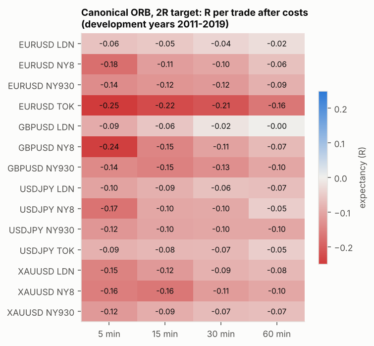
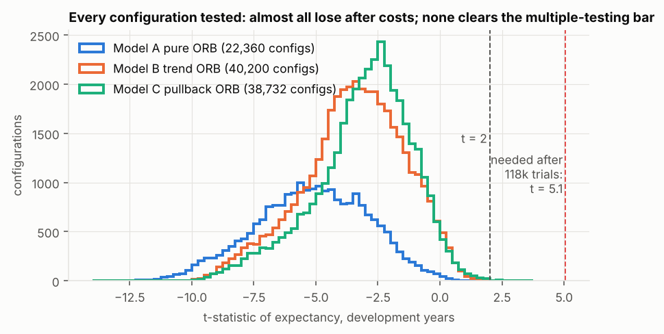

### 4.2 Management and filters (Parts 3–4)

Change in expectancy from adding one element to the canonical ORB, median over the 56 market/session/length bases:

| component | bases | change dev (R) | bases better dev | change val (R) | bases better val | trades kept |
|---|---|---|---|---|---|---|
| break-even at 0.75R | 56 | -0.004 | 34% | +0.004 | 62% | 100% |
| break-even at 1.0R | 56 | -0.003 | 36% | +0.002 | 52% | 100% |
| break-even at 1.25R | 56 | -0.000 | 48% | +0.001 | 57% | 100% |
| chandelier 2.0 x ATR10 (no target) | 56 | -0.002 | 48% | -0.011 | 36% | 100% |
| chandelier 2.0 x ATR14 (no target) | 56 | -0.003 | 45% | -0.012 | 34% | 100% |
| chandelier 2.0 x ATR20 (no target) | 56 | -0.003 | 46% | -0.015 | 34% | 100% |
| chandelier 2.5 x ATR10 (no target) | 56 | +0.003 | 57% | -0.006 | 45% | 100% |
| chandelier 2.5 x ATR14 (no target) | 56 | +0.002 | 52% | -0.009 | 36% | 100% |
| chandelier 2.5 x ATR20 (no target) | 56 | +0.000 | 50% | -0.014 | 34% | 100% |
| chandelier 3.0 x ATR10 (no target) | 56 | -0.000 | 48% | -0.006 | 43% | 100% |
| chandelier 3.0 x ATR14 (no target) | 56 | -0.000 | 48% | -0.002 | 50% | 100% |
| chandelier 3.0 x ATR20 (no target) | 56 | +0.002 | 54% | -0.003 | 46% | 100% |
| chandelier 3.5 x ATR10 (no target) | 56 | +0.002 | 54% | +0.001 | 52% | 100% |
| chandelier 3.5 x ATR14 (no target) | 56 | +0.002 | 54% | -0.012 | 43% | 100% |
| chandelier 3.5 x ATR20 (no target) | 56 | -0.000 | 50% | -0.002 | 46% | 100% |
| 50% at 1R + chandelier 3 x ATR14 | 56 | -0.000 | 50% | +0.001 | 50% | 100% |
| 50% at 1R + BE 1R + chandelier 3 | 56 | -0.001 | 48% | -0.001 | 48% | 100% |

| component | bases | change dev (R) | bases better dev | change val (R) | bases better val | trades kept |
|---|---|---|---|---|---|---|
| filter w:10~90 | 56 | -0.002 | 41% | +0.004 | 57% | 80% |
| filter w:20~80 | 56 | -0.004 | 45% | +0.002 | 52% | 60% |
| filter w:0~80 | 56 | -0.011 | 18% | -0.012 | 20% | 80% |
| filter w:20~100 | 56 | +0.011 | 70% | +0.016 | 80% | 79% |
| filter w:30~70 | 56 | -0.002 | 46% | +0.005 | 52% | 41% |
| filter v:0.8~1.25 | 56 | -0.001 | 50% | -0.017 | 32% | 56% |
| filter v:1.0~99 | 56 | +0.022 | 73% | +0.013 | 57% | 41% |
| filter v:0~1.0 | 56 | -0.017 | 25% | -0.018 | 43% | 56% |
| skip impulsive bar > 1.5 ATR | 56 | -0.004 | 39% | -0.007 | 38% | 80% |
| skip impulsive bar > 2.0 ATR | 56 | -0.001 | 46% | -0.006 | 30% | 91% |
| skip impulsive bar > 3.0 ATR | 56 | -0.001 | 43% | -0.001 | 39% | 98% |
| cancel after > 0 failed attempts | 56 | +0.001 | 52% | -0.002 | 45% | 68% |
| cancel after > 1 failed attempts | 56 | -0.000 | 48% | +0.004 | 62% | 88% |
| cancel after > 2 failed attempts | 56 | -0.000 | 48% | +0.000 | 50% | 96% |
| breakout activity >= 1.0 x (USDJPY) | 16 | +0.001 | 56% | +0.003 | 50% | 95% |
| breakout activity >= 1.5 x (USDJPY) | 16 | +0.007 | 56% | -0.019 | 31% | 70% |
| breakout activity >= 2.0 x (USDJPY) | 16 | -0.001 | 44% | -0.045 | 31% | 35% |

- Break-even, chandelier exits and partial profits change expectancy by about ±0.01R: **noise**.
- Skipping the impulsive breakout bar does not help: chasing is not the problem.
- Cancelling after failed attempts does nothing; fading failed breakouts (E6) has no edge either (best t = 0.33).
- The activity filter on USDJPY is negative in validation.
- One filter helps consistently: **skipping sessions whose opening range is in the narrowest 20% of the last 100** (+0.011R development, better in 70% of bases; +0.016R validation, better in 80%). Trading only when daily volatility is above its 1-year median also helps a little. Neither turns a losing base into a winner.

### 4.3 Ablation (Part 8)

All 56 market/session/length combinations pooled:

| variant | dev n | dev E | dev t | val E | val t | OOS n | OOS E | OOS t | OOS E before costs |
|---|---|---|---|---|---|---|---|---|---|
| ORB alone | 117,904 | -0.107 | -30.963 | -0.096 | -16.540 | 40,977 | -0.088 | -15.013 | +0.018 |
| ORB + ema | 72,795 | -0.103 | -23.062 | -0.100 | -13.208 | 25,529 | -0.070 | -9.200 | +0.040 |
| ORB + vol | 71,189 | -0.110 | -24.593 | -0.092 | -12.327 | 24,904 | -0.092 | -12.183 | +0.013 |
| ORB + retest | 95,585 | -0.144 | -37.080 | -0.128 | -20.044 | 34,530 | -0.120 | -18.475 | -0.001 |
| ORB + pb2 | 85,663 | -0.070 | -19.858 | -0.066 | -11.253 | 29,333 | -0.057 | -9.615 | +0.019 |
| ORB + chand | 117,904 | -0.108 | -34.252 | -0.089 | -16.388 | 40,977 | -0.093 | -17.472 | +0.013 |
| ORB + be | 117,904 | -0.110 | -34.509 | -0.094 | -17.502 | 40,977 | -0.087 | -15.997 | +0.019 |
| 2 +EMA50 (cumulative) | 72,795 | -0.103 | -23.062 | -0.100 | -13.208 | 25,529 | -0.070 | -9.200 | +0.040 |
| 3 +vol filter (cumulative) | 44,368 | -0.102 | -17.590 | -0.104 | -10.736 | 15,666 | -0.079 | -8.162 | +0.029 |
| 4 +retest (cumulative) | 35,897 | -0.151 | -23.200 | -0.147 | -13.892 | 13,166 | -0.119 | -11.049 | +0.005 |
| 5 +2-candle pullback (instead of retest) (cumulative) | 24,822 | -0.073 | -11.074 | -0.068 | -6.077 | 8,492 | -0.039 | -3.449 | +0.037 |
| 6 +chandelier (cumulative) | 24,822 | -0.070 | -14.987 | -0.053 | -6.530 | 8,492 | -0.065 | -8.420 | +0.011 |
| 7 +break-even (cumulative) | 24,822 | -0.070 | -15.076 | -0.054 | -6.597 | 8,492 | -0.067 | -9.011 | +0.008 |
| 8 full spec (stop below the pullback low) (cumulative) | 12,813 | -0.197 | -13.227 | -0.160 | -6.174 | 5,451 | -0.228 | -11.863 | -0.025 |

London session only:

| variant | dev n | dev E | dev t | val E | val t | OOS n | OOS E | OOS t | OOS E before costs |
|---|---|---|---|---|---|---|---|---|---|
| ORB alone | 33,388 | -0.067 | -9.448 | -0.087 | -7.315 | 11,736 | -0.090 | -7.555 | +0.019 |
| ORB + ema | 20,184 | -0.059 | -6.333 | -0.110 | -7.125 | 7,166 | -0.085 | -5.516 | +0.028 |
| ORB + vol | 20,207 | -0.070 | -7.647 | -0.079 | -5.143 | 7,091 | -0.093 | -5.982 | +0.014 |
| ORB + retest | 26,688 | -0.099 | -12.360 | -0.114 | -8.806 | 9,965 | -0.120 | -9.214 | +0.002 |
| ORB + pb2 | 23,895 | -0.046 | -5.955 | -0.072 | -5.498 | 8,201 | -0.056 | -4.137 | +0.026 |
| ORB + chand | 33,388 | -0.098 | -17.768 | -0.095 | -10.669 | 11,736 | -0.105 | -11.487 | +0.004 |
| ORB + be | 33,388 | -0.075 | -11.776 | -0.083 | -7.686 | 11,736 | -0.096 | -8.931 | +0.013 |
| 2 +EMA50 (cumulative) | 20,184 | -0.059 | -6.333 | -0.110 | -7.125 | 7,166 | -0.085 | -5.516 | +0.028 |
| 3 +vol filter (cumulative) | 12,244 | -0.055 | -4.604 | -0.104 | -5.256 | 4,352 | -0.099 | -4.972 | +0.012 |
| 4 +retest (cumulative) | 9,762 | -0.104 | -7.697 | -0.134 | -6.221 | 3,679 | -0.148 | -6.864 | -0.020 |
| 5 +2-candle pullback (instead of retest) (cumulative) | 6,933 | -0.033 | -2.271 | -0.055 | -2.216 | 2,321 | -0.070 | -2.740 | +0.012 |
| 6 +chandelier (cumulative) | 6,933 | -0.083 | -9.652 | -0.038 | -2.478 | 2,321 | -0.089 | -6.822 | -0.008 |
| 7 +break-even (cumulative) | 6,933 | -0.082 | -9.557 | -0.038 | -2.482 | 2,321 | -0.087 | -6.658 | -0.006 |
| 8 full spec (stop below the pullback low) (cumulative) | 3,023 | -0.209 | -6.409 | -0.007 | -0.107 | 1,137 | -0.230 | -5.069 | -0.003 |

Gold, London only:

| variant | dev n | dev E | dev t | val E | val t | OOS n | OOS E | OOS t | OOS E before costs |
|---|---|---|---|---|---|---|---|---|---|
| ORB alone | 7,107 | -0.107 | -6.948 | -0.118 | -4.870 | 2,901 | -0.100 | -4.080 | +0.014 |
| ORB + ema | 4,080 | -0.059 | -2.804 | -0.107 | -3.436 | 1,808 | -0.094 | -2.983 | +0.024 |
| ORB + vol | 4,418 | -0.079 | -3.970 | -0.099 | -3.149 | 1,703 | -0.115 | -3.597 | -0.001 |
| ORB + retest | 4,579 | -0.113 | -5.822 | -0.154 | -5.801 | 2,442 | -0.101 | -3.738 | +0.026 |
| ORB + pb2 | 5,161 | -0.078 | -4.448 | -0.098 | -3.488 | 1,979 | -0.123 | -4.416 | -0.039 |
| ORB + chand | 7,107 | -0.162 | -16.550 | -0.115 | -6.690 | 2,901 | -0.102 | -5.050 | +0.013 |
| ORB + be | 7,107 | -0.124 | -9.060 | -0.113 | -5.154 | 2,901 | -0.104 | -4.738 | +0.011 |
| 2 +EMA50 (cumulative) | 4,080 | -0.059 | -2.804 | -0.107 | -3.436 | 1,808 | -0.094 | -2.983 | +0.024 |
| 3 +vol filter (cumulative) | 2,572 | -0.040 | -1.502 | -0.071 | -1.748 | 1,058 | -0.143 | -3.557 | -0.026 |
| 4 +retest (cumulative) | 1,638 | -0.056 | -1.655 | -0.096 | -2.185 | 902 | -0.109 | -2.437 | +0.025 |
| 5 +2-candle pullback (instead of retest) (cumulative) | 1,555 | +0.039 | +1.170 | +0.015 | +0.277 | 567 | -0.184 | -3.580 | -0.098 |
| 6 +chandelier (cumulative) | 1,555 | -0.093 | -5.295 | +0.018 | +0.527 | 567 | -0.155 | -6.143 | -0.068 |
| 7 +break-even (cumulative) | 1,555 | -0.095 | -5.461 | +0.017 | +0.509 | 567 | -0.150 | -5.972 | -0.064 |
| 8 full spec (stop below the pullback low) (cumulative) | 201 | -0.109 | -0.991 | -0.045 | -0.369 | 294 | -0.291 | -3.770 | -0.069 |

What each component does:
- **EMA trend filter:** removes about 40% of trades and changes expectancy by +0.004R in development, −0.004R in validation and +0.018R in the final years. Small, not reliable.
- **Volatility filter (20th–80th percentile):** no improvement. Only cutting the narrowest ranges helps (section 4.2).
- **Retest entry:** clearly **worse** (−0.03 to −0.04R in every period). Breakouts that come back to the level are disproportionately the ones that fail.
- **Two-candle pullback entry:** the only component that improves every period (+0.03 to +0.04R), and still negative after costs.
- **Chandelier and break-even:** no reliable effect.
- **Stop beyond the pullback swing (the full spec):** the worst change. Tight stops halve the trade count (most fall under the 3x-cost minimum) and push costs to about 0.23R per trade.

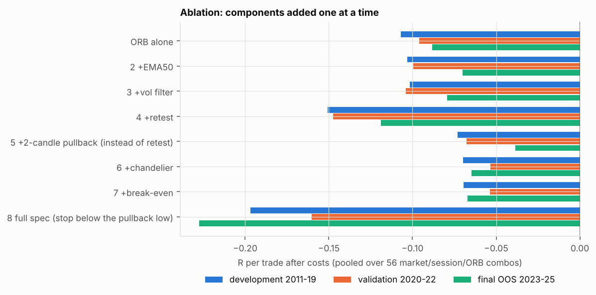

### 4.4 Walk-forward (2014–2022)

| model | trades | E (always trade) | t | trades (gated, score>=1) | E (gated) | t (gated) | positive years |
|---|---|---|---|---|---|---|---|
| A pure ORB | 22,555 | -0.110 | -9.409 | 1,946 | -0.091 | -2.122 | 0/9 |
| B trend ORB | 13,389 | -0.125 | -9.495 | 3,409 | -0.083 | -3.058 | 0/9 |
| C pullback ORB | 8,258 | -0.094 | -5.055 | 3,038 | -0.092 | -2.935 | 1/9 |
| A+B+C pooled | 9,043 | -0.107 | -6.469 | 4,308 | -0.076 | -2.860 | 0/9 |

Picking the best stable ORB settings from recent history and trading them the next year lost money in 26 of 27 model-years, even when it only traded when the training evidence was good ("gated").

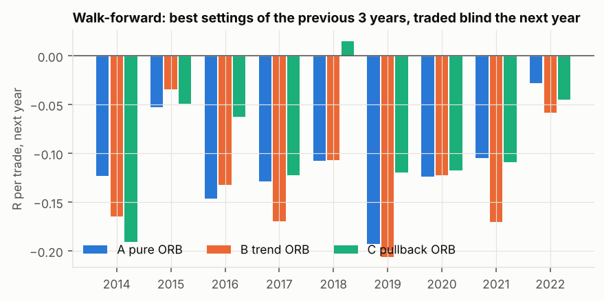

In-sample and out-of-sample expectancy are correlated (+0.55), but that comes from persistent losers (bad sessions stay bad). The best 1% of configurations in-sample (1,011 configs) averaged **-0.086R per trade** in validation.

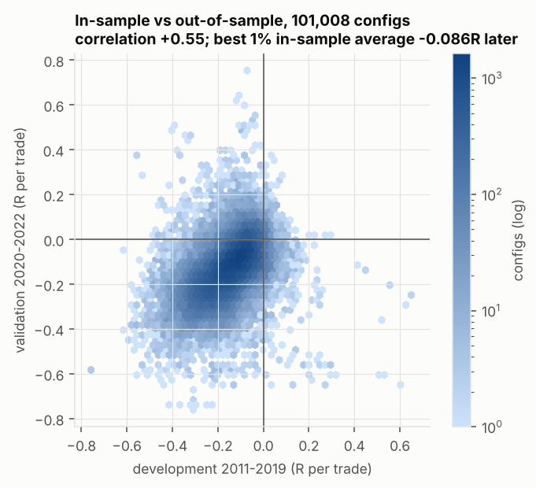

### 4.5 Validation of the short list (2020–2022)

| model | sym | session | orb | dev robust score | dev E | dev t | val n | val E | val t |
|---|---|---|---|---|---|---|---|---|---|
| B | EURUSD | LDN | 60 | +1.170 | +0.081 | +1.725 | 202 | -0.138 | -1.890 |
| B | XAUUSD | LDN | 60 | +1.231 | +0.105 | +1.536 | 309 | +0.009 | +0.088 |
| C | EURUSD | LDN | 15 | +1.263 | +0.129 | +1.731 | 65 | -0.258 | -2.225 |
| C | USDJPY | NY8 | 30 | +1.512 | +0.139 | +1.741 | 87 | -0.128 | -1.048 |
| C | XAUUSD | LDN | 5 | +2.156 | +0.254 | +2.276 | 129 | -0.288 | -2.716 |
| A | GBPUSD | LDN | 60 | +0.554 | +0.023 | +0.775 | 658 | +0.018 | +0.366 |

The strongest development candidate (gold London pullback, +0.25R, t = 2.3) is **significantly negative** in validation (−0.29R, t = −2.7). Gold 2019 was already an uploaded-file year and was that candidate's best year, and EURUSD failed in 2020–21 while still on tick-built data, so the break is real, not a data-source artefact.

### 4.6 The four best configurations (Part 9D) and the final test

| cfg | name | market | experiment id | filter | bias |
|---|---|---|---|---|---|
| A | Best pure ORB (Model A) | GBPUSD LDN ORB60 | E1-12484 | - | - |
| B | Best trend-filtered ORB (Model B) | XAUUSD LDN ORB60 | E2-2166 | - | H4 EMA20 neutral z=0.25 |
| C | Best pullback-continuation ORB (Model C) | XAUUSD LDN ORB5 | E3-385 | - | H4 EMA50 body |
| X | Best robust combined (Model B + skip narrowest 20% of ORs) | XAUUSD LDN ORB60 | E5-1291 | w:20~100 | H4 EMA20 neutral z=0.25 |

Full Part 7 statistics ($100,000 account, 0.5% risk per trade, lot-rounded, after costs):

| cfg | period | trades | net profit $ | CAGR | PF | win | avg win R | avg loss R | E (R) | E before costs | t | max DD | recovery | Sharpe | Sortino | max losing streak | avg hold (min) | long E | short E | % months up |
|---|---|---|---|---|---|---|---|---|---|---|---|---|---|---|---|---|---|---|---|---|
| A | dev 2011-19 | 1918 | 19,566 | +2.0% | 1.04 | 40% | 1.35 | -0.87 | +0.023 | +0.084 | +0.775 | 22.4% | 0.87 | 0.25 | 0.32 | 12 | 280 | -0.015 | +0.063 | 52% |
| A | val 2020-22 | 658 | 4,633 | +1.5% | 1.03 | 42% | 1.27 | -0.89 | +0.018 | +0.075 | +0.366 | 22.9% | 0.20 | 0.21 | 0.25 | 11 | 290 | +0.014 | +0.022 | 56% |
| A | oos 2023-25 | 643 | -33,122 | -12.6% | 0.79 | 34% | 1.37 | -0.88 | -0.122 | -0.044 | -2.477 | 33.3% | -1.00 | -1.41 | -1.72 | 8 | 283 | -0.020 | -0.234 | 25% |
| A | all 2011-25 | 3219 | -16,273 | -1.2% | 0.99 | 39% | 1.33 | -0.88 | -0.007 | +0.056 | -0.315 | 39.5% | -0.41 | -0.08 | -0.10 | 13 | 283 | -0.010 | -0.004 | 47% |
| B | dev 2011-19 | 741 | 43,095 | +4.3% | 1.17 | 33% | 2.17 | -0.93 | +0.105 | +0.239 | +1.536 | 17.2% | 2.51 | 0.52 | 0.57 | 16 | 270 | -0.061 | +0.258 | 50% |
| B | val 2020-22 | 309 | 264 | +0.1% | 1.01 | 34% | 1.85 | -0.94 | +0.009 | +0.093 | +0.088 | 15.6% | 0.02 | 0.05 | 0.06 | 11 | 278 | -0.083 | +0.113 | 47% |
| B | oos 2023-25 | 318 | -20,393 | -7.4% | 0.79 | 29% | 1.84 | -0.94 | -0.139 | -0.065 | -1.631 | 20.7% | -0.98 | -0.93 | -0.94 | 13 | 268 | -0.146 | -0.126 | 33% |
| B | all 2011-25 | 1368 | 14,133 | +0.9% | 1.04 | 33% | 2.02 | -0.94 | +0.027 | +0.135 | +0.565 | 31.7% | 0.45 | 0.15 | 0.16 | 16 | 272 | -0.090 | +0.160 | 46% |
| C | dev 2011-19 | 332 | 49,648 | +4.8% | 1.44 | 37% | 2.28 | -0.92 | +0.254 | +0.392 | +2.276 | 8.2% | 6.03 | 0.76 | 0.63 | 13 | 269 | +0.201 | +0.337 | 44% |
| C | val 2020-22 | 129 | -17,095 | -6.1% | 0.57 | 26% | 1.49 | -0.90 | -0.288 | -0.202 | -2.716 | 17.9% | -0.96 | -1.52 | -0.82 | 14 | 245 | -0.342 | -0.182 | 28% |
| C | oos 2023-25 | 108 | -6,526 | -2.2% | 0.82 | 31% | 1.74 | -0.94 | -0.119 | -0.038 | -0.829 | 10.5% | -0.62 | -0.48 | -0.28 | 9 | 244 | -0.026 | -0.482 | 34% |
| C | all 2011-25 | 569 | 15,911 | +1.0% | 1.10 | 33% | 2.05 | -0.92 | +0.060 | +0.176 | +0.803 | 26.6% | 0.60 | 0.21 | 0.15 | 17 | 259 | +0.024 | +0.130 | 39% |
| X | dev 2011-19 | 562 | 52,617 | +5.1% | 1.27 | 37% | 1.99 | -0.92 | +0.159 | +0.275 | +2.141 | 15.1% | 3.49 | 0.72 | 0.67 | 13 | 286 | -0.028 | +0.336 | 54% |
| X | val 2020-22 | 233 | 15,352 | +4.9% | 1.23 | 37% | 1.90 | -0.92 | +0.132 | +0.207 | +1.120 | 7.4% | 2.07 | 0.63 | 0.66 | 11 | 292 | -0.002 | +0.273 | 56% |
| X | oos 2023-25 | 241 | -17,453 | -6.2% | 0.76 | 31% | 1.59 | -0.94 | -0.155 | -0.089 | -1.741 | 18.0% | -0.97 | -1.00 | -0.80 | 12 | 278 | -0.148 | -0.168 | 31% |
| X | all 2011-25 | 1036 | 45,435 | +2.6% | 1.13 | 36% | 1.89 | -0.93 | +0.080 | +0.175 | +1.518 | 20.0% | 2.28 | 0.39 | 0.36 | 13 | 286 | -0.057 | +0.235 | 49% |

Robustness on 2011–2022 (before the final years were read): cost and latency stress, deflated Sharpe, and 3-year Monte Carlo resampling by whole months:

| cfg | base | cost x1.5 | cost x2 | delay +1m | delay +2m | DSR (dev) | trade Sharpe | Sharpe needed (SR0) | MC 3y median DD | MC 3y 95% DD | MC 3y P(loss) |
|---|---|---|---|---|---|---|---|---|---|---|---|
| A | +0.022 (t +0.85) | -0.007 (t -0.29) | -0.037 (t -1.51) | +0.022 (t +0.85) | +0.022 (t +0.85) | 0.000 | 0.018 | 0.336 | 14.2% | 26.6% | 36% |
| B | +0.077 (t +1.37) | +0.019 (t +0.34) | -0.044 (t -0.81) | +0.072 (t +1.30) | +0.066 (t +1.19) | 0.000 | 0.056 | 0.336 | 10.9% | 19.9% | 25% |
| C | +0.102 (t +1.18) | -0.008 (t -0.11) | -0.046 (t -0.60) | +0.102 (t +1.18) | +0.102 (t +1.18) | 0.000 | 0.125 | 0.336 | 7.8% | 14.7% | 30% |
| X | +0.151 (t +2.41) | +0.070 (t +1.19) | +0.016 (t +0.27) | +0.150 (t +2.38) | +0.144 (t +2.29) | 0.000 | 0.090 | 0.336 | 7.6% | 13.6% | 10% |

Extra latency only affects market-order entries (B and X). A and C enter with resting stop orders, so their delay rows equal the base. Configuration X survives 1.5x costs in 2011–2022 but not 2x, and was chosen with knowledge of 2020–2022, so only its 2023–2025 result is a clean test, and that result is negative.

Market regimes (trend from the daily 200-day average and its slope; volatility from daily ATR against its 1-year median; shock = inside a listed disruption window such as the 2015 SNB unpeg, the 2016 Brexit vote, the 2020 COVID crash, the 2022 gilt crisis, the 2024 yen carry unwind or the 2025 tariff shock):

| cfg | regime | 2011-22 n | 2011-22 E | 2023-25 n | 2023-25 E |
|---|---|---|---|---|---|
| A | trend:bull | 763 | +0.052 | 391 | -0.054 |
| A | trend:bear | 1159 | -0.005 | 45 | -0.235 |
| A | trend:sideways | 654 | +0.032 | 207 | -0.225 |
| A | vol:high | 498 | +0.029 | 64 | -0.280 |
| A | vol:normal | 1594 | +0.021 | 430 | -0.141 |
| A | vol:low | 484 | +0.016 | 149 | +0.003 |
| A | shock | 165 | +0.081 | 14 | +0.474 |
| B | trend:bull | 378 | +0.077 | 291 | -0.185 |
| B | trend:bear | 378 | +0.067 | 7 | +1.210 |
| B | trend:sideways | 294 | +0.089 | 20 | +0.064 |
| B | vol:high | 191 | +0.110 | 101 | -0.314 |
| B | vol:normal | 655 | +0.032 | 174 | -0.095 |
| B | vol:low | 204 | +0.190 | 43 | +0.096 |
| B | shock | 67 | +0.572 | 8 | -0.508 |
| C | trend:bull | 168 | +0.120 | 97 | -0.160 |
| C | trend:bear | 168 | +0.042 | 4 | +0.782 |
| C | trend:sideways | 125 | +0.160 | 7 | -0.071 |
| C | vol:high | 89 | +0.164 | 41 | +0.040 |
| C | vol:normal | 274 | -0.030 | 56 | -0.160 |
| C | vol:low | 98 | +0.416 | 11 | -0.507 |
| C | shock | 35 | -0.051 | 1 | +0.496 |
| X | trend:bull | 294 | +0.114 | 218 | -0.202 |
| X | trend:bear | 283 | +0.165 | 6 | +1.578 |
| X | trend:sideways | 218 | +0.183 | 17 | -0.164 |
| X | vol:high | 132 | +0.123 | 68 | -0.129 |
| X | vol:normal | 496 | +0.140 | 136 | -0.184 |
| X | vol:low | 167 | +0.206 | 37 | -0.095 |
| X | shock | 50 | +0.464 | 7 | -0.438 |

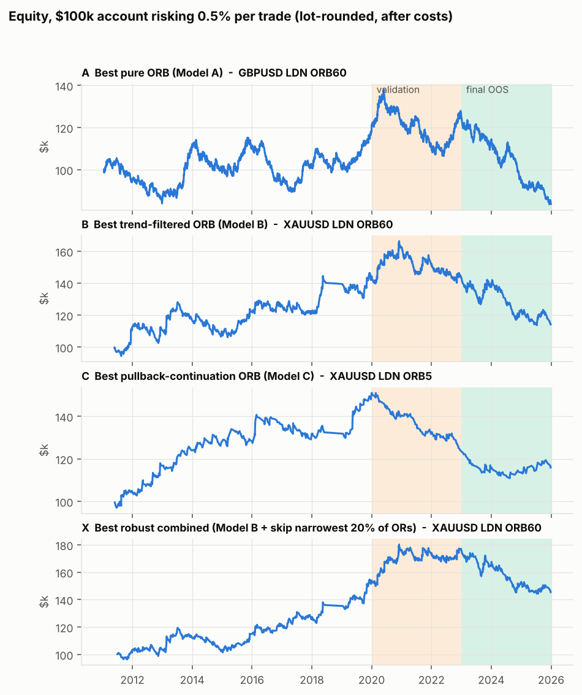
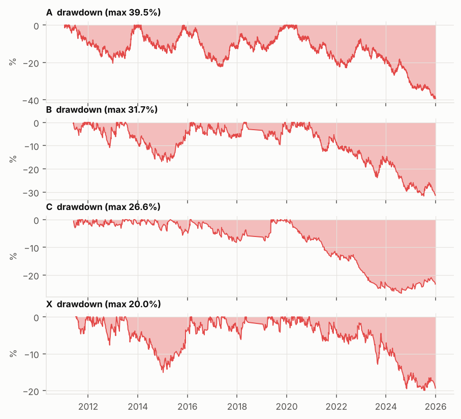
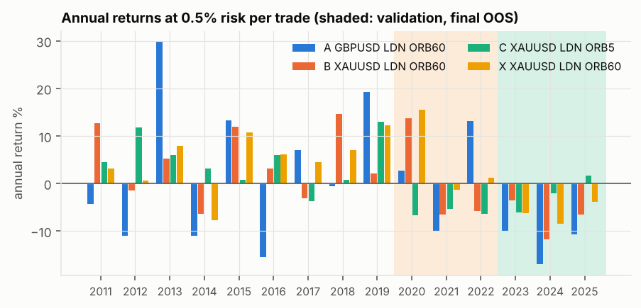
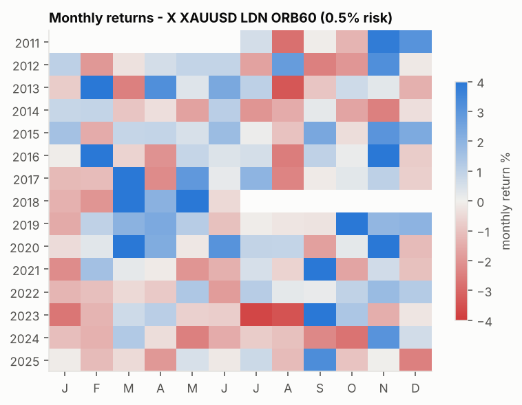
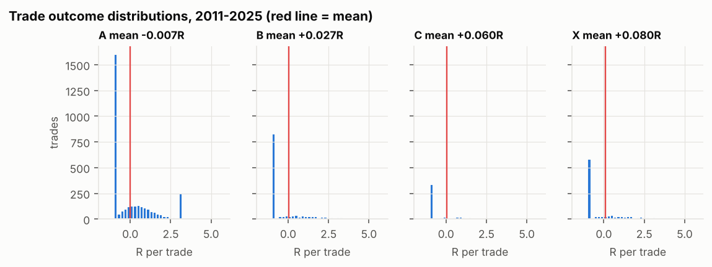
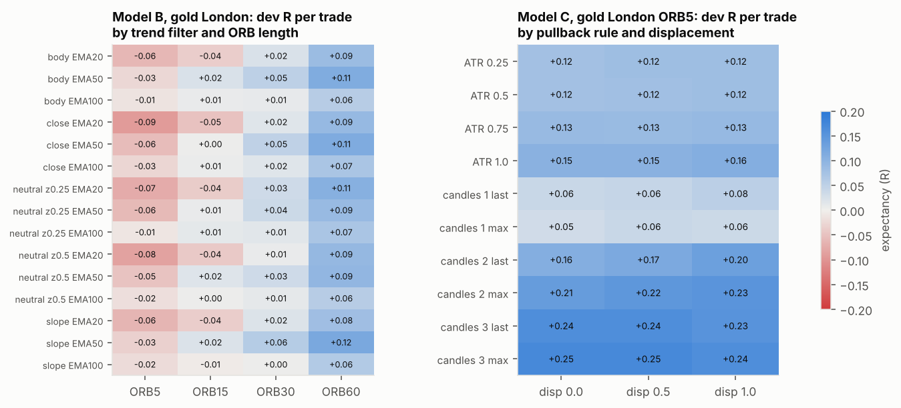
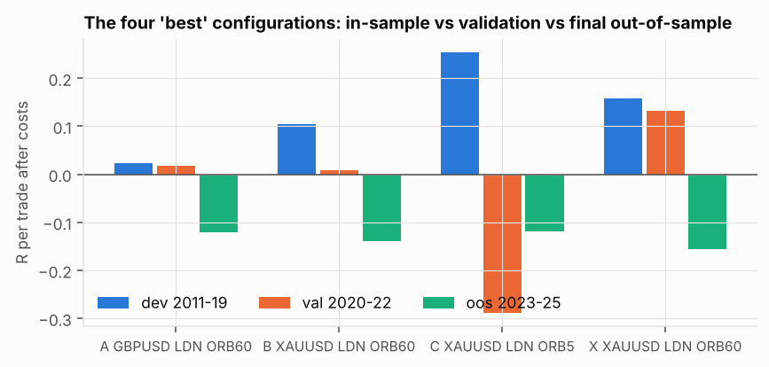

Note on the sensitivity chart: the gold Model C region is broad and stable in-sample (every pullback rule and displacement is positive), exactly what Part 5 asks for, and it still failed. A stable region inside one regime is not robustness across regimes.

## 5. What worked, what failed, and why

**Worked (relatively):** the two-candle pullback entry (+0.03R), skipping the narrowest 20% of opening ranges (+0.01–0.02R), London over New York/Tokyo, longer ranges over 5-minute ranges. None of these makes ORB profitable after costs.

**Failed:** pure ORB in every market/session/length; the H4 EMA filter as an edge source; retest entries; break-even; chandelier exits; partials; impulsive-bar, failed-attempt and activity filters; fading failed breakouts; the full combined specification.

**Why:**
1. **No continuation edge at these opens.** Spot FX and spot gold trade around the clock, so the London and New York "opens" are not price-discovery auctions. Opening-range breakouts continue about as often as they fail: +0.01R before costs, pooled.
2. **Costs are large relative to ORB stops.** A stop at the far side of a 15-minute range is typically 4–9 times the cost, so every trade pays 0.10–0.15R before it starts (0.23R with pullback-swing stops).
3. **Selection bias.** With 100,000+ variants, some look good by chance. The best in-sample 1% were negative later; the deflated Sharpe ratio of every finalist is 0.
4. **Regime dependence.** The trend-filtered gold results were shorts in a gold bear market; the filter did not turn that into an all-weather effect (their longs lost in every period, including the 2023–2025 bull market). The gold pullback version worked on both sides in 2011–2019 and stopped working on both sides from 2020.

**Instruments:** none qualifies. **Sessions:** none qualifies; London is least bad, the New York opens and Tokyo for EURUSD are worst. **Conditions to avoid (if anyone trades ORB anyway):** the New York opens, very narrow opening ranges, tight structure-based stops, retest entries.

Not tested because the data does not contain it: equity-index futures at their cash open (ES/NQ at 09:30 New York), where published ORB research is concentrated. That would need exchange data with a real opening auction.

## 6. Strategy specification (Part 9B)

Exact rules of the engine, so every number here can be reproduced or ported. Shown for configuration X (the "best robust combined"); the other configurations differ only in the parameters listed in section 4.6 and `results/orb_final.json`.

Notation: day d; session open T_o and close T_c in local time converted to UTC; opening-range length L = 60 minutes; cost c = $0.45; prices are bid.

1. **Opening range.** Window [T_o, T_o + L) on 1-minute bars. ORH = max high, ORL = min low. Valid only if at least 0.8·L minutes exist and ORH > ORL.
2. **Execution bars.** 5-minute bars aligned to UTC multiples of 5 minutes. ATR_j = simple average of the true range over the last 14 bars.
3. **Entry window.** Bars with open time in [T_o + L, T_o + 3h).
4. **Trend bias.** H4 bars start at 02, 06, 10, 14, 18, 22 UTC. EMA20 of H4 closes. At 5-minute bar j, use the last H4 bar k that closed at or before bar j's close. Bias = +1 if close_k − EMA_k > 0.25·ATR14(H4)_k; −1 if < −0.25·ATR14(H4)_k; otherwise 0.
5. **Range filter.** w_d = (ORH − ORL) / ATR14 of daily UTC bars (last completed day). Trade the session only if w_d is at or above the 20th percentile of w over the previous 100 sessions (at least 20 needed).
6. **Long signal.** The first bar j in the window with close_j > ORH, long side armed, bias_j = +1. Short mirror: close_j < ORL, bias_j = −1.
7. **Entry.** Market order at the open of the first minute after bar j closes. Long fill = bid open + c; short fill = bid open.
8. **Stop.** Long: ORL (sell on bid ≤ ORL). Short: ORH (buy when ask = bid + c ≥ ORH). Risk = |fill − stop|. Skip if risk < 3c.
9. **Exit.** Stop as above, filled at the stop or the worse open after a gap; otherwise at the open of the first minute at or after T_c (16:30 London). No target, no break-even, no trailing.
10. **Limits.** At most one trade per session per instrument. Pending orders (other models) expire at T_o + 3h.
11. **Sizing.** lots = floor(0.005 · equity / (risk · 100 oz) / 0.01) · 0.01; skip if below 0.01 lot.

Model C (configuration C) replaces steps 6–8. After the breakout close, wait until the highest high since the breakout exceeds ORH + 0.5·ATR (displacement). Then require 3 consecutive bearish bars. Place a buy stop at the highest high of those pullback bars, following further pullback bars. Cancel if a bar closes back below ORH or at T_o + 3h. Stop at ORL. Exit at the session close.

## 7. MT5 Expert Advisor

Not built. Part 9E asks for an EA only if the results justify it, and they do not. The rules in section 6 are complete enough to port one later (one terminal, one chart per instrument), but no tested configuration has a positive out-of-sample expectancy to implement.

## 8. Reproduce

```
cd research/orb
python3 data_audit.py && python3 session_audit.py       # Part 1
python3 experiments.py E0 E1 E2 E3 E6                    # grids (2011-2022 only)
python3 refine.py E4 E5 && python3 ablation.py           # management, filters, ablation
python3 walkforward.py && python3 component_effects.py && python3 ablation_report.py
python3 final.py                                         # locked configs, final years (logged)
python3 report.py && python3 report_md.py                # figures and this report
```

Every experiment (parameters plus per-year trade count, sum of R, sum of R², wins, losses and cost) is in `results/orb_experiments/*.csv.gz`.
